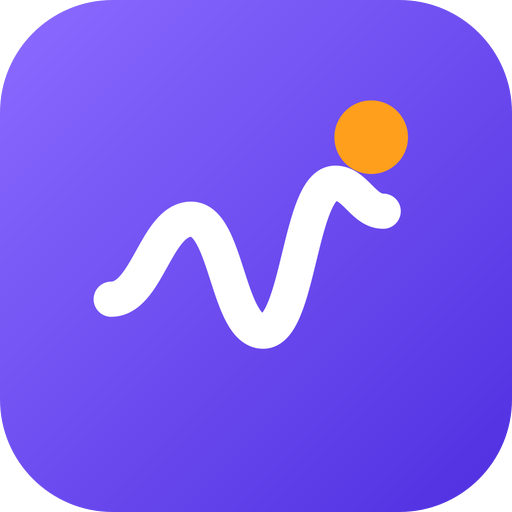

<p align="left">
  
</p>

# Excellent Mind: Neurofeedback Games for Children

An attention-training app for children, built with Expo / React Native for Android tablets. A child wears a BrainLink-Lite EEG headset, and the headset's attention score drives eight games: nothing moves unless the child pays attention. Every result syncs to a school web dashboard, so the lab in-charge can follow each student's brainwave progress.

| Part | Where |
| :--- | :--- |
| Tablet app (Expo SDK 58) | repository root |
| School dashboard (Node.js, no npm packages) | `dashboard/` |
| Screen-by-screen map | [docs/FLOWS.md](docs/FLOWS.md) |

---

## Contents

- [Set up the school dashboard](#set-up-the-school-dashboard)
- [Add a tablet](#add-a-tablet)
- [The dashboard](#the-dashboard)
- [Games](#games)
- [Profile](#profile)
- [Is the data real?](#is-the-data-real)
- [Headset behaviour](#headset-behaviour)
- [For developers](#for-developers)

---

## Set up the school dashboard

Do this once, on the lab PC that stays on during sessions.

1. Install [Node.js](https://nodejs.org) 22.13 or newer.
2. Start the server:

   ```powershell
   cd dashboard
   npm start
   ```

3. The console prints the dashboard address, the **school key** and the **admin password**. They are generated on first run and kept in `dashboard/data/config.json` (not in Git). To choose your own, set the `SCHOOL_NAME`, `SCHOOL_KEY`, `ADMIN_PASSWORD` or `PORT` environment variables.
4. Let the tablets reach the PC. Run this once in an administrator PowerShell:

   ```powershell
   New-NetFirewallRule -DisplayName "Excellent Mind dashboard" -Direction Inbound -Protocol TCP -LocalPort 4000 -Action Allow
   ```

5. Give the PC a fixed IP address on the school Wi-Fi (a DHCP reservation in the router), so the address on the tablets never changes.
6. Optional: start it with Windows. Put a shortcut to a `.cmd` file containing `cd /d C:\path\to\excellent-mind\dashboard && npm start` in the Startup folder (`Win + R`, then `shell:startup`).

Back up `dashboard/data/` now and then: it holds every synced result.

## Add a tablet

The school starts with 4 tablets for 20 children. Each new tablet takes about 10 minutes.

1. **Install the app.** Open the latest Android build from the project's EAS Builds page on the tablet and tap **Install** (allow "Install unknown apps" for the browser when asked). From a PC with USB debugging on, `adb install -r excellent-mind.apk` also works.
2. **Pair the headset.** Switch on the BrainLink-Lite, open Android **Settings → Bluetooth** and pair **BrainLink_Lite**. Each tablet needs its own headset. Close any other headset app, because the headset talks to one app at a time.
3. **Connect to the dashboard.** In the app open **Settings → School dashboard** and enter:
   - the server address the dashboard console shows for "Tablets & other PCs", for example `http://192.168.1.20:4000`
   - the school key
   - a tablet name that is unique and written on the tablet, for example `Lab tablet 5`

   Tap **Save & connect**. The tablet must be on the same Wi-Fi as the PC.
4. **Add the children.** Create a profile for each child who uses this tablet. On **Profile → Edit details** give each child their **Student ID** and **Class**.
5. **Check it.** Play one short activity. The child appears on the dashboard and the tablet shows under **Tablets**.

Tips for a growing lab:

- Give each child a home tablet, about 5 children per tablet. With 4 tablets that covers the current 20 children; add a tablet for every 5 new children.
- Always use the school's real Student ID. If a child has to use another tablet, create them there with the **same Student ID** and the dashboard merges both into one student.
- Results wait on the tablet when the Wi-Fi is down and sync on their own later.

## The dashboard

Open the dashboard address in a browser and sign in with the admin password. It shows only what is needed to follow each student:

- **Summary tiles:** students, active in the last 7 days, activities played, average attention change, students improving.
- **One card per student:** current attention and its change, a brainwave bar chart (delta, theta, alpha, beta and gamma, first 3 activities against latest 3), the theta/beta ratio, and an attention trend line.
- **Filters:** class, search by name or Student ID, sort by name, most improved, needs support or last active.
- **Student detail** (click a card): band bars first vs latest, every band per activity, attention per activity, and the full activity history.
- **Tablets:** each tablet that syncs and when it last did.
- **Export CSV** of every activity for the school management system.

Lower theta/beta usually goes with steadier attention, so a falling theta/beta and a rising attention line are good signs.

## Games

Training is attention based, like Excellent Brain. Every game is controlled by the headset's 0 to 100 attention score, and nothing moves on its own.

- Below the target the game stalls: the runner stops, the rocket sinks, the flowers wilt. At the target it moves, and higher attention drives it harder. Rewards only happen while attention is on target.
- During play a live **attention meter** shows the child's attention against the target line, with a short prompt telling them to pay attention or to keep going.
- Every 250 ms on target adds points times a streak multiplier. The target adapts up or down with the child.

| Game | How attention controls it |
| :--- | :--- |
| Rail Rush | Attention is the runner's speed; on target it collects coins and jumps hurdles, off target it slows and trips |
| Sky Glider | The glider's height follows attention; strong attention threads the high golden rings |
| Rocket Climb | Attention is thrust; without it the engine cuts out and the rocket sinks |
| Turbo Kart | Your speed is your attention; the rival keeps a steady pace, so overtake it |
| Hoop Shot | Attention charges the power meter (it drains without it); a full meter scores |
| Star Blaster | The laser fires only with attention; missed asteroids hit the shield |
| Reef Friends | The fish rises and swims with attention to reach bubbles and gather friends |
| Magic Garden | Attention grows the flowers; without it they wilt back |

There is also a guided 30-session journey and a video mode where the picture stays bright while attention is on target and dims as it drops.

## Profile

Name, age, class and Student ID (Edit details), sessions done, average attention, time on target, minutes played, an attention chart per activity, the child's brainwave profile (first vs latest), the progress questionnaire, and the dashboard sync status.

## Is the data real?

Settings → Headset → **Live sensor check** shows numbers measured from the Bluetooth stream every second: raw EEG samples per second (about 512 for BrainLink-Lite), attention and band-power updates per second, the poor-signal value (200 means the sensor is off the head) and the device address. There is no simulator or demo data in the app or the dashboard.

## Headset behaviour

- Sensor off the forehead: a "No signal" banner shows, and the activity clock and score pause until contact returns.
- Headset switched off: the status shows "Reconnecting…", and the app reconnects by itself when it is switched back on.

## For developers

```powershell
npm install
npx expo start --dev-client
```

- **Installable APK** (no PC needed on the tablet): `npx eas-cli build -p android --profile preview`.
- **Development build:** `npx eas-cli build -p android --profile development`, then `npx expo start --dev-client`.
- Expo Go opens the UI but has no Bluetooth, so there is no brain signal there.

| Area | Where |
| :--- | :--- |
| ThinkGear packet parser (attention, meditation, raw 512 Hz, 8 bands, signal) | `src/eeg/thinkgear.ts` |
| BrainLink-Lite over Bluetooth Classic SPP | `src/eeg/sources.ts` |
| Live signal, auto-connect, watchdog, auto-reconnect, sensor check | `src/eeg/EegProvider.tsx` |
| Scoring, streak multiplier, adaptive target, per-activity brainwave averages | `src/games/engine.ts` |
| Game scenes | `src/games/scenes/` |
| Accounts, settings, history, journey progress (stored on the tablet) | `src/store/AppStore.tsx` |
| Brainwave metrics (first vs latest) | `src/store/metrics.ts` |
| Sync to the school dashboard | `src/sync/SyncProvider.tsx` |
| School dashboard server (Node, built-in SQLite) and web UI | `dashboard/server.mjs`, `dashboard/public/` |
| English / Tamil / Hindi strings | `src/i18n/strings.ts` |
| Theme and brand name | `src/constants/theme.ts`, `src/constants/brand.ts` |
| Sounds and icons are generated, not downloaded | `scripts/gen-audio.js`, `scripts/gen-icons.js` |
